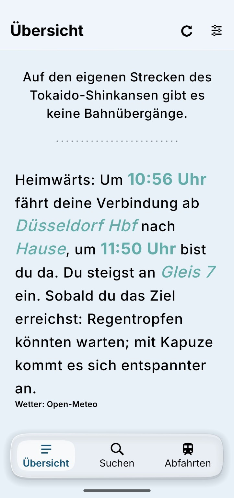

  

<h1 align="center">Öpen-V</h1>

  Freie Android-App für Bus und Bahn: deine Wege als Netzplan, Verbindungen im direkten Vergleich, Abfahrten als Anzeigetafel. 
  Kostenlos, werbefrei, ohne Konto und ohne Tracking.

  
  
  

  

## Worum es geht

Öpen-V ist für Menschen gedacht, die regelmäßig dieselben Wege mit Bus und Bahn fahren. Statt jedes Mal Start und Ziel einzutippen, legt man seine Orte einmal an. Danach sieht man auf einen Blick, wann es losgeht, wo man umsteigt und ob sich das Warten auf die nächste Fahrt lohnt.

Die App ist quelloffen und kommt ohne Werbung, Konto, Analyse-Dienste und Google Play Services aus. Favoriten und Einstellungen bleiben auf dem Gerät.

## Stand

Version 1.0 ist fertig und im Alltag in Gebrauch. Die Veröffentlichung bei Google Play wird vorbereitet.

- **Verbindungen und Abfahrten** mit Echtzeit, Störungsmeldungen und Gleisangaben
- **Netzplan** der eigenen Lieblingsorte: ein Tipp auf eine Strecke sucht die nächsten Fahrten
- **Balkendiagramm**, das kommende und gerade verpasste Verbindungen nebeneinanderstellt
- **Anzeigetafel** und Widgets für den Startbildschirm
- **Reisebegleitung** für eine laufende Fahrt mit Hinweisen zu Umstiegen und Alternativen
- Deutsch und Englisch, helles und dunkles Design, große Schrift, TalkBack

Die Fahrplandaten kommen von **VRR OpenService**, die Auskunft deckt damit Rhein-Ruhr ab. Ein Haltestellenverzeichnis für ganz Deutschland ist offline in der App enthalten. Rund 600 automatisierte Tests laufen bei jeder Änderung.

  
  
  

## Ausblick

Öpen-V soll in ganz Deutschland funktionieren, nicht nur im Rhein-Ruhr-Gebiet. Die App ist darauf vorbereitet: Der Fahrplandienst ist austauschbar, ohne dass sich an Oberfläche und Funktionen etwas ändert ([Fahrplandienste](docs/timetable-services.md)).

## Umgang mit Fahrplandaten

- Abfragen nur auf Anfrage oder solange eine Ansicht sichtbar ist; Widgets nur bei eingeschaltetem Bildschirm
- höchstens drei Anfragen gleichzeitig, gleiche Anfragen werden gebündelt, `Retry-After` wird beachtet
- kein Massenabruf, keine Weitergabe der Daten als Bild oder Text
- sichtbare Quellenangabe in App, Benachrichtigungen und Widgets
- Softwarelizenz (GPL) und Datennutzung sind getrennt; es gelten die Bedingungen des Anbieters

Details: [Datenquellen und Nutzungsbedingungen](docs/data-sources.md)

## Ausprobieren

- **App:** Test-App „Öpen-V · Vorschau“ unter [Releases](https://github.com/Ambivalenton/openv-release/releases), ab Android 8
- **Selbst bauen:** JDK 17 und Android SDK 36, dann `./gradlew :app:assemblePreview` ([Entwicklung](docs/development.md))
- **Aufbau der App:** [Architektur](docs/architecture.md)

## Datenschutz und Lizenz

[Datenschutzerklärung](https://ambivalenton.github.io/openv-release/privacy/) · [Lizenz (GPL-3.0-or-later)](LICENSE) · [Drittanbieter-Lizenzen](THIRD_PARTY_NOTICES.md)

Öpen-V ist ein unabhängiges Projekt und keine offizielle App eines Verkehrsverbunds oder Verkehrsunternehmens.

## Kontakt

Erik Tomczyk (Ambivalenton) · [oepenvapp@gmail.com](mailto:oepenvapp@gmail.com) · [Issues](https://github.com/Ambivalenton/openv-release/issues) · [Mitmachen](CONTRIBUTING.md)

---

**English:** Öpen-V is a free, ad-free Android app for public transport (GPL-3.0). Version 1.0 uses VRR OpenService for the Rhine-Ruhr region and ships an offline stop directory for all of Germany. The timetable service is replaceable, so the app is ready for Germany-wide journey planning.
