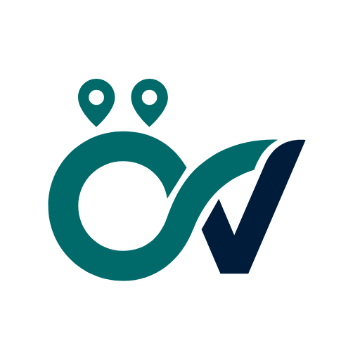
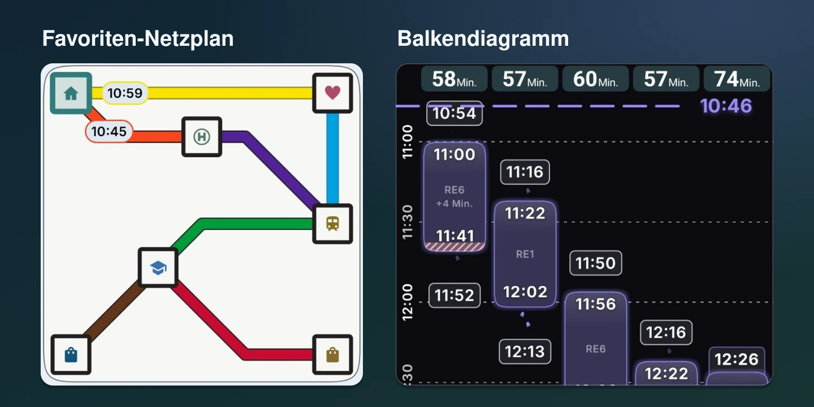
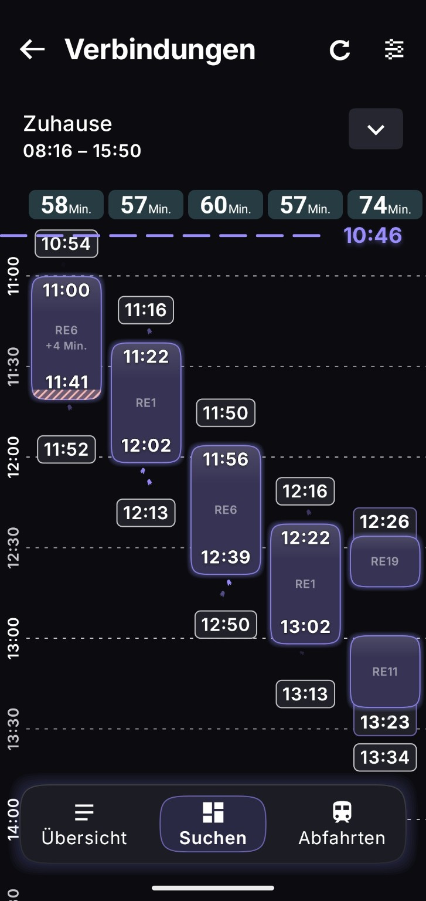
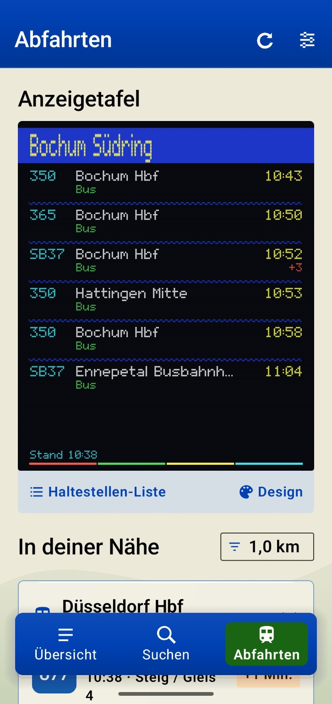

  

<h1 align="center">Öpen-V</h1>

  Dein eigener Netzplan für Bus und Bahn. 
  Eine freie, werbefreie Android-App für die Wege, die du immer wieder fährst.

  <a href="https://github.com/Ambivalenton/openv-release/releases/tag/vorschau"><strong>Vorschau herunterladen</strong></a> ·
  <a href="https://ambivalenton.github.io/openv-release/">Projektseite</a> ·
  <a href="docs/data-sources.md">Datenquellen</a>

  

## Unterwegs mit Öpen-V

**Wann muss ich los?** Lege Zuhause, Arbeit oder deinen Treffpunkt als Favoriten an. Ein Tipp auf die Strecke im Netzplan zeigt dir die nächsten Verbindungen. Wenn du lieber liest, fasst die Übersicht Abfahrt, Umstieg und Ankunft in einem kurzen Text zusammen.

**Lohnt sich der spätere Zug?** Im Balkendiagramm hat jede Verbindung eine eigene Spalte. Auf derselben Zeitachse siehst du, welche Fahrt früher ankommt, wie lang der Fußweg ist und wie viel Zeit dir zum Umsteigen bleibt.

**Wo steige ich um?** Hefte deine Fahrt an. Die Reisebegleitung hält den nächsten Umstieg und verfügbare Gleisangaben griffbereit. Für den täglichen Blick vor dem Losgehen gibt es die Abfahrtstafel auch als Widget auf dem Startbildschirm.

## Vorschau installieren

1. Öffne das [Vorschau-Release](https://github.com/Ambivalenton/openv-release/releases/tag/vorschau). Dort stehen die aktuelle Version und die Änderungen.
2. Lade unter **Assets** die Datei mit der Endung `.apk` herunter und öffne sie auf deinem Android-Gerät. Die Vorschau benötigt **Android 8 oder neuer und einen ARM64-Prozessor**.
3. Starte **Öpen-V · Vorschau**. Du kannst zum Einstieg zwei Orte als Favoriten anlegen oder gleich eine Verbindung suchen. Für einen manuellen Start brauchst du keine Standortfreigabe.

## Abdeckung und Datenschutz

| Was du suchst | Was Öpen-V liefert |
| --- | --- |
| Verbindungen, Abfahrten und Umstiege | Online-Auskunft über VRR OpenService mit Schwerpunkt Rhein-Ruhr. Prognosen, Ausfälle und Gleisänderungen erscheinen, soweit der Anbieter sie liefert. |
| Eine Haltestelle in Deutschland | Der mitgelieferte Katalog aus dem Zentralen Haltestellenverzeichnis (ZHV) von DELFI lässt sich offline durchsuchen. Für Fahrzeiten und Routen braucht die App eine Online-Auskunft. |
| Deine gespeicherten Orte | Favoriten und Einstellungen bleiben auf deinem Gerät. Die App kommt ohne Konto, Werbung, Tracking und Google Play Services aus. Für Online-Auskünfte kommuniziert sie direkt mit den jeweiligen Diensten. |

[Alle Datenquellen und Abrufregeln](docs/data-sources.md) · [Datenschutzerklärung](https://ambivalenton.github.io/openv-release/privacy/)

## Screenshots

  
  
  

[Netzplan ansehen](docs/images/favoriten-netzplan.jpg) · [Verbindungssuche ansehen](docs/images/suche.jpg) · [Drei Designs vergleichen](docs/images/designvergleich.webp)

## Entwicklung und Kontakt

Mit JDK 17 und Android SDK 36 baust du die Vorschau unter Linux oder macOS mit `./gradlew :app:assemblePreview`, unter Windows mit `.\gradlew.bat :app:assemblePreview`. Voraussetzungen, Tests und Ausgabevarianten stehen in der [Entwicklungsanleitung](docs/development.md).

[Architektur](docs/architecture.md) · [Fahrplandienste](docs/timetable-services.md) · [Änderungsprotokoll](CHANGELOG.md) · [CI auf main](https://github.com/Ambivalenton/openv-release/actions/workflows/ci.yml?query=branch%3Amain)

Öpen-V ist ein unabhängiges Projekt von Erik Tomczyk (Ambivalenton). Fragen zu Fahrplandaten und Kooperationen erreichen ihn unter [oepenvapp@gmail.com](mailto:oepenvapp@gmail.com). Für Fehlerberichte und Vorschläge gibt es die [GitHub-Issues](https://github.com/Ambivalenton/openv-release/issues) und den [Leitfaden zum Mitmachen](CONTRIBUTING.md).

Der Quellcode steht unter der [GPL-3.0-or-later](LICENSE). Für Fahrplandaten, Karten und weitere eingebundene Inhalte gelten die jeweiligen [Quellen- und Lizenzhinweise](THIRD_PARTY_NOTICES.md).

### English

Öpen-V is a free, ad-free Android app for everyday trips by public transport. Connect your favourite places on a personal network map, compare journeys on a shared timeline and pin a trip to follow your transfers. Live journey planning uses VRR OpenService with a Rhine-Ruhr focus. The nationwide DELFI stop directory is searchable offline. [Download the ARM64 preview](https://github.com/Ambivalenton/openv-release/releases/tag/vorschau) · [Privacy policy in English](PRIVACY_EN.md)
