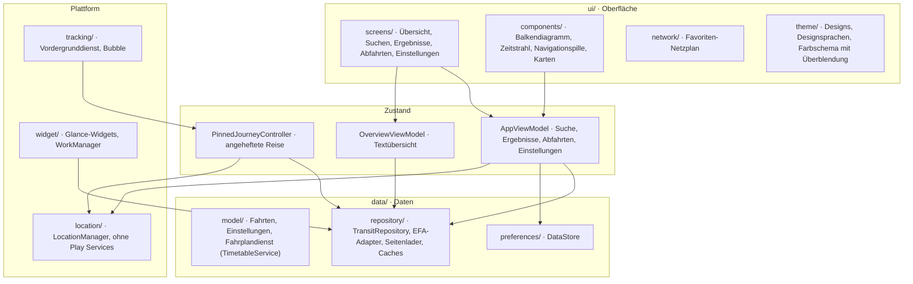
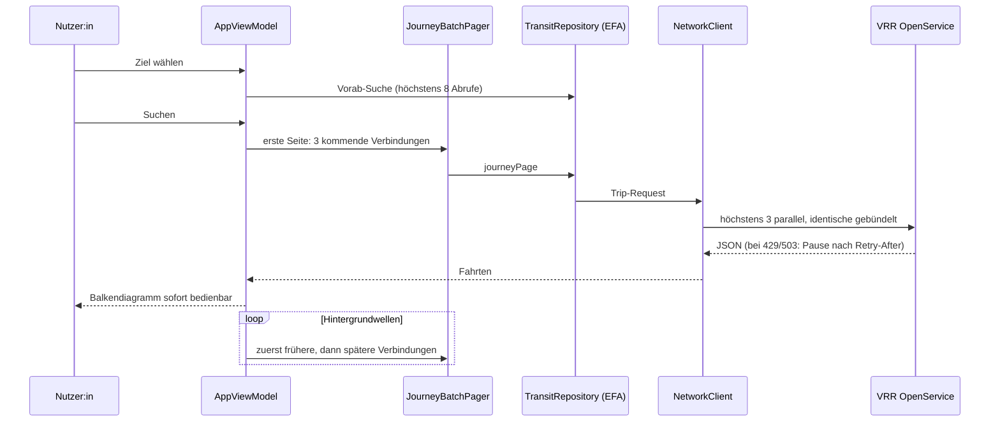

# Architektur

Öpen-V ist eine einzelne Android-App in Kotlin mit Jetpack Compose (Material 3 Expressive). Es gibt keinen eigenen Server: Die App spricht direkt mit öffentlichen Diensten und speichert alles Persönliche lokal.

## Schichten

Abhängigkeiten werden mit [Koin](https://insert-koin.io/) in `OpenVApp` verdrahtet. Alle UI-Zustände fließen als `StateFlow` von den ViewModels zu Compose; eine Ansicht hält keinen eigenen Fahrplanzustand.

## Eine Suche von Tipp bis Balken

Die Ladefolge ist in `JourneyBatchPager.kt` festgelegt (`CONNECTION_WAVES`, `CONNECTION_WAVE_ORDER`): drei kommende, drei vergangene, drei kommende, drei vergangene, drei kommende; danach je drei in Wischrichtung. Antworten einer älteren Suche verändern den aktuellen Zustand nie (`historyGeneration`).

## Wichtige Bausteine

| Baustein | Datei | Aufgabe |
| --- | --- | --- |
| Fahrplandienst | `data/model/TimetableService.kt` | Beschreibung des angesprochenen Dienstes; Auswahl per `openv.timetable` |
| EFA-Adapter | `data/repository/EfaTransitRepository.kt` | StopFinder, Trip, DM, AddInfo → App-Modelle |
| Netzwerk | `data/repository/NetworkClient.kt` | Parallelitätsgrenze, Bündelung, `Retry-After`, User-Agent |
| Seitenlader | `data/repository/JourneyBatchPager.kt` | Ladefolge des Balkendiagramms, Identitäten ohne Duplikate |
| Reisebegleitung | `data/repository/PinnedJourneyController.kt`, `tracking/` | Aktualisierung, Fortschritt, Alternativen, Benachrichtigung |
| Widgets | `widget/WidgetRefreshScheduler.kt` | 15-Minuten-Takt nur bei eingeschaltetem Bildschirm, Nachladen beim Entsperren |
| Haltestellen offline | `data/repository/StaticStopCatalog.kt`, `assets/stops/` | DELFI-Verzeichnis als FTS-Katalog |
| Designs | `ui/theme/` | Farbschema, Designsprachen; Farbwechsel blenden 460 ms über |
| Texte | `localization/`, `ui/…/tr()` | Deutsche Vorlagen, englischer Katalog aus `localization/en.json` |

## Leitlinien

- **Aktualität vor allem:** Sollzeit, Prognose, tatsächliche Zeit und lokale Schätzung bleiben getrennt; fehlende Echtzeit heißt nicht pünktlich.
- **Datenschutz:** kein Konto, keine Analyse, keine proprietären SDKs. Bewegungs- und Standortdaten verlassen das Gerät nicht, außer als nötige Koordinaten einer Anfrage.
- **Energie:** ereignisgesteuert statt Dauerschleifen; Sensoren und Standort werden abgemeldet, sobald niemand sie braucht.
- **Barrierefreiheit:** große Schrift, TalkBack und Kontraste werden mit Robolectric-Tests geprüft.

