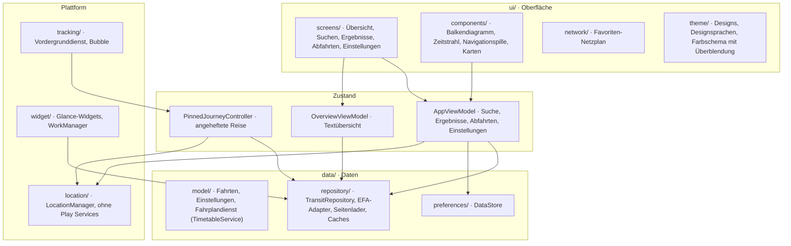
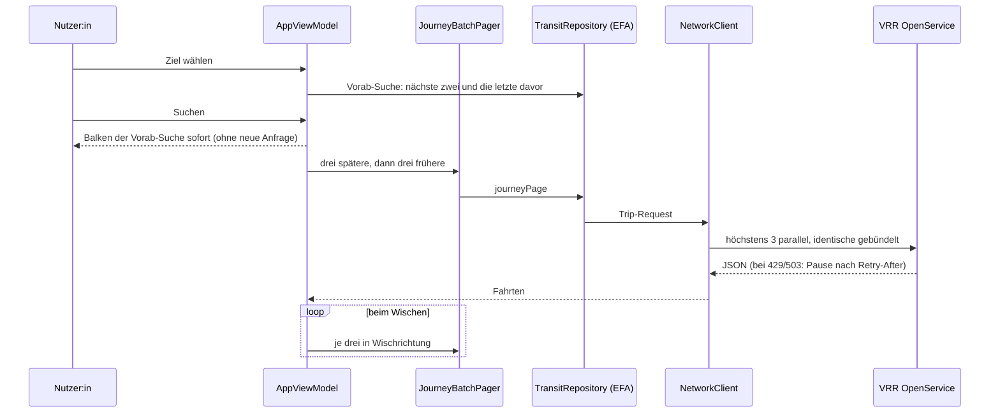

# Architektur

Öpen-V ist eine einzelne Android-App in Kotlin mit Jetpack Compose (Material 3 Expressive). Es gibt keinen eigenen Server: Die App spricht direkt mit öffentlichen Diensten und speichert alles Persönliche lokal.

## Schichten

Abhängigkeiten werden mit [Koin](https://insert-koin.io/) in `OpenVApp` verdrahtet. Alle UI-Zustände fließen als `StateFlow` von den ViewModels zu Compose; eine Ansicht hält keinen eigenen Fahrplanzustand.

## Eine Suche von Tipp bis Balken

Die Ladefolge ist in `JourneyBatchPager.kt` festgelegt (`CONNECTION_WAVES`, `completeWaves`): Vorab-Suche bei der Zielwahl mit den nächsten zwei Verbindungen auf der gesuchten Seite und der nächsten auf der anderen; nach „Suchen“ drei weitere auf der gesuchten Seite, dann drei auf der anderen; danach je drei in Wischrichtung. Ohne Vorab-Suche ist die erste Seite drei Verbindungen auf der gesuchten Seite. Bei „Ankunft“ schließt die spätere Seite an die letzte noch rechtzeitig ankommende Verbindung an. Frühere Verbindungen schauen so weit zurück, wie der Takt der geladenen Verbindungen nahelegt (`fetchHistoricalConnections`, `cadenceHint`). Antworten einer älteren Suche verändern den aktuellen Zustand nie (`historyGeneration`).

## Wichtige Bausteine

| Baustein | Datei | Aufgabe |
| --- | --- | --- |
| Fahrplandienst | `data/model/TimetableService.kt` | Beschreibung des angesprochenen Dienstes; Auswahl per `openv.timetable` |
| EFA-Adapter | `data/repository/EfaTransitRepository.kt` | StopFinder, Trip, DM, AddInfo → App-Modelle |
| Netzwerk | `data/repository/NetworkClient.kt` | Parallelitätsgrenze, Bündelung, `Retry-After`, User-Agent |
| Seitenlader | `data/repository/JourneyBatchPager.kt` | Ladefolge des Balkendiagramms, Identitäten ohne Duplikate |
| Reisebegleitung | `data/repository/PinnedJourneyController.kt`, `tracking/` | Aktualisierung, Fortschritt, Alternativen, Benachrichtigung |
| Widgets | `widget/WidgetRefreshScheduler.kt` | 15-Minuten-Takt nur bei eingeschaltetem Bildschirm, Nachladen beim Entsperren |
| Haltestellen offline | `data/repository/StaticStopCatalog.kt`, `assets/stops/` | DELFI-Verzeichnis als FTS-Katalog |
| Designs | `ui/theme/` | Farbschema, Designsprachen; Farbwechsel blenden 460 ms über |
| Texte | `localization/`, `ui/…/tr()` | Deutsche Vorlagen, englischer Katalog aus `localization/en.json` |

## Favoriten hinzufügen (ab 1.0.1)

Ein Ablauf für das Blatt „Favorit hinzufügen“ und die Ersteinrichtung (`ui/dialogs/FavoriteStudio.kt`, Zustand `FavoriteDraft` in `data/model/FavoriteCreation.kt`):

1. **Ort** – das Suchfeld steht oben, seine Treffer direkt darunter (über der Tastatur). Ohne Eingabe: Rollen („Zuhause“, „Arbeit“ …; die Suche fragt dann nach diesem Ort) und „Oft gesucht“ – Ziele, die mindestens zweimal gesucht wurden, ohne Favoriten und Orte im Umkreis von 150 m um einen Favoriten.
2. **Aussehen** – großes Live-Symbol, Name, Ortsart als Kacheln, Farbe; „Alle Symbole“ und „Mehr“ klappen im Blatt auf, es öffnet sich kein weiteres Fenster.
3. **Gespeichert** – der Favorit ist bereits gespeichert; angeboten werden Verbinden (mit „Zuhause“ oder dem nächsten Favoriten), „Noch einen Favoriten“ und „Fertig“.

Was die Person selbst gewählt hat, ersetzt kein Vorschlag (getippter Name, angetippte Rolle). Das Blatt behält seine Höhe; nur der Inhalt wechselt mit einer Feder. Zeitregeln, Verkehrsfilter und Rolle im Netzplan stehen beim Bearbeiten eines Favoriten.

## Netzplan bearbeiten (ab 1.0.4)

Die Werkzeugleiste (`ui/network/NetworkEditBar.kt`) belegt immer die Höhe ihrer Zeile; geöffnet ist sie doppelt so hoch und reicht mit dem Gesten-Band nach oben über die Zeile „Abfahrt/Ankunft“, die dafür zur Seite fliegt (`ScheduleControls(modeAway)`). So bleibt der Netzplan an seinem Platz. Beim Verschieben eines Favoriten teilen Leiste und Plan einen `NetworkDeleteZone`-Zustand: Die Leiste zeigt die Lösch-Zone und meldet ihre Lage, der Plan prüft beim Ziehen, ob der Finger darüber ist, und löscht beim Loslassen dort (mit „Rückgängig“).

## Ersteinrichtung

Drei Schritte: Freigaben (Standort, Mitteilungen – erst auf „Erlauben“), erster Favorit, Design (sechs ausgewählte Designs). Startbildschirm und Einrichtung sind eine Ebene des App-Overlays (`AppDialog`, `ui/onboarding/OnboardingWizard.kt`) über Hauptansicht und Navigationsleiste. Ein normal eingefügtes Element läge unter der deckenden Hauptansicht (Fehler von Build 96 bis 100). Nach dem Abschluss blendet die Ebene aus.

## Blätter und Tastatur

`DirectModalSheet` misst seine Höhe am größten bisher gesehenen Fenster. Öffnet sich die Tastatur, bleibt die Oberkante des Blatts stehen und nur der untere Teil weicht aus; die Bewegung wird nicht neu angelegt, das Blatt fährt also nicht ein zweites Mal ein.

## Farben der Navigationskapsel

Übersicht behält die Akzentfarbe des Designs. Suchen und Abfahrten nehmen Farben des Designs (Palette und kuratierte Farbfamilie), die mindestens 70° Farbton entfernt liegen, sonst die Farbharmonie des Akzents (Triade, dann ±150°). Zwischen zwei Seiten blendet die Kapsel in OkLCh über den Farbkreis (`ui/components/PillColors.kt`). Monochrome Designs behalten drei Graustufen.

## Leitlinien

- **Aktualität vor allem:** Sollzeit, Prognose, tatsächliche Zeit und lokale Schätzung bleiben getrennt; fehlende Echtzeit heißt nicht pünktlich.
- **Datenschutz:** kein Konto, keine Analyse, keine proprietären SDKs. Bewegungs- und Standortdaten verlassen das Gerät nicht, außer als nötige Koordinaten einer Anfrage.
- **Energie:** ereignisgesteuert statt Dauerschleifen; Sensoren und Standort werden abgemeldet, sobald niemand sie braucht.
- **Barrierefreiheit:** große Schrift, TalkBack und Kontraste werden mit Robolectric-Tests geprüft.

