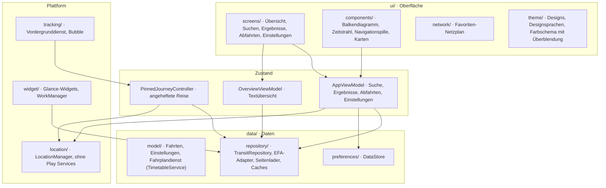
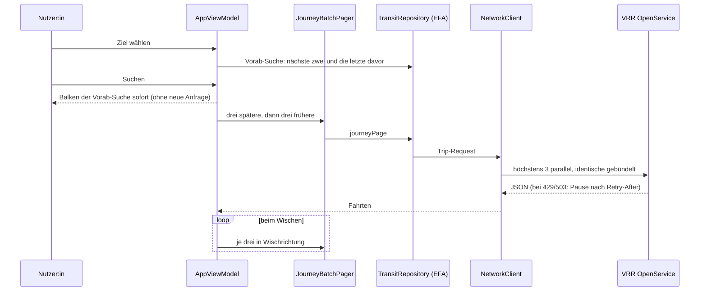

# Architektur

Öpen-V ist eine einzelne Android-App in Kotlin mit Jetpack Compose (Material 3 Expressive). Es gibt keinen eigenen Server: Die App spricht direkt mit öffentlichen Diensten und speichert alles Persönliche lokal.

## Schichten

Abhängigkeiten werden mit [Koin](https://insert-koin.io/) in `OpenVApp` verdrahtet. Alle UI-Zustände fließen als `StateFlow` von den ViewModels zu Compose; eine Ansicht hält keinen eigenen Fahrplanzustand.

## Eine Suche von Tipp bis Balken

Die Ladefolge ist in `JourneyBatchPager.kt` festgelegt (`CONNECTION_WAVES`, `completeWaves`): Vorab-Suche bei der Zielwahl mit den nächsten zwei Verbindungen auf der gesuchten Seite und der nächsten auf der anderen; nach „Suchen“ drei weitere auf der gesuchten Seite, dann drei auf der anderen; danach je drei in Wischrichtung. Ohne Vorab-Suche ist die erste Seite drei Verbindungen auf der gesuchten Seite. Bei „Ankunft“ schließt die spätere Seite an die letzte noch rechtzeitig ankommende Verbindung an. Frühere Verbindungen schauen so weit zurück, wie der Takt der geladenen Verbindungen nahelegt (`fetchHistoricalConnections`, `cadenceHint`). Antworten einer älteren Suche verändern den aktuellen Zustand nie (`historyGeneration`).

## Wichtige Bausteine

| Baustein | Datei | Aufgabe |
| --- | --- | --- |
| Fahrplandienst | `data/model/TimetableService.kt` | Beschreibung des angesprochenen Dienstes; Auswahl per `openv.timetable` |
| EFA-Adapter | `data/repository/EfaTransitRepository.kt` | StopFinder, Trip, DM, AddInfo → App-Modelle |
| Netzwerk | `data/repository/NetworkClient.kt` | Parallelitätsgrenze, Bündelung, `Retry-After`, User-Agent |
| Seitenlader | `data/repository/JourneyBatchPager.kt` | Ladefolge des Balkendiagramms, Identitäten ohne Duplikate |
| Reisebegleitung | `data/repository/PinnedJourneyController.kt`, `tracking/` | Aktualisierung, Fortschritt, Alternativen, Benachrichtigung |
| Widgets | `widget/WidgetRefreshScheduler.kt` | 15-Minuten-Takt nur bei eingeschaltetem Bildschirm, Nachladen beim Entsperren |
| Haltestellen offline | `data/repository/StaticStopCatalog.kt`, `assets/stops/` | DELFI-Verzeichnis als FTS-Katalog |
| Designs | `ui/theme/` | Farbschema, Designsprachen; Farbwechsel blenden 460 ms über |
| Texte | `localization/`, `ui/…/tr()` | Deutsche Vorlagen, englischer Katalog aus `localization/en.json` |

## Favoriten hinzufügen (ab 1.0.1)

Ein Ablauf für das Blatt „Favorit hinzufügen“ und die Ersteinrichtung (`ui/dialogs/FavoriteStudio.kt`, Zustand `FavoriteDraft` in `data/model/FavoriteCreation.kt`):

1. **Ort** – das Suchfeld steht oben, seine Treffer direkt darunter (über der Tastatur). Ohne Eingabe: Rollen („Zuhause“, „Arbeit“ …; die Suche fragt dann nach diesem Ort) und „Oft gesucht“ – Ziele, die mindestens zweimal gesucht wurden, ohne Favoriten und Orte im Umkreis von 150 m um einen Favoriten.
2. **Aussehen** – großes Live-Symbol, Name, Ortsart als Kacheln, Farbe; „Alle Symbole“ und „Mehr“ klappen im Blatt auf, es öffnet sich kein weiteres Fenster.
3. **Gespeichert** – der Favorit ist bereits gespeichert; angeboten werden Verbinden (mit „Zuhause“ oder dem nächsten Favoriten), „Noch einen Favoriten“ und „Fertig“.

Was die Person selbst gewählt hat, ersetzt kein Vorschlag (getippter Name, angetippte Rolle). Das Blatt behält seine Höhe; nur der Inhalt wechselt mit einer Feder. Zeitregeln, Verkehrsfilter und Rolle im Netzplan stehen beim Bearbeiten eines Favoriten.

## Netzplan bearbeiten (ab 1.0.4)

Die Werkzeugleiste (`ui/network/NetworkEditBar.kt`) belegt immer die Höhe ihrer Zeile; geöffnet ist sie doppelt so hoch und reicht mit dem Gesten-Band nach oben über die Zeile „Abfahrt/Ankunft“, die dafür zur Seite fliegt (`ScheduleControls(modeAway)`). Die Kapsel darin hängt an zwei weichen Federn (je Ende eine, `CapsuleSway`), die die Beschleunigung der Zeile spüren: Sie dehnt sich, schwingt nach und wird an der Kante gestaucht, ohne harte Grenze. So bleibt der Netzplan an seinem Platz. Beim Verschieben eines Favoriten teilen Leiste und Plan einen `NetworkDeleteZone`-Zustand: Die Leiste zeigt die Lösch-Zone und meldet ihre Lage, der Plan prüft beim Ziehen, ob der Finger darüber ist, und löscht beim Loslassen dort (mit „Rückgängig“).

Ab 1.1.9: Gedrückthalten einer Linie im Bearbeitungsmodus (`NetworkPlanActions.onEdgeDelete`) lässt sie zittern (`lineTremble`, über die Long-Press-Zeit) und in Konfetti zerspringen (`PlanConfetti.kt`: `confettiAlong`, `drawConfetti`, eigene Ebene nur während des Flugs); entfernt wird über `removeEdge`, „Rückgängig“ wie beim Menü. Kreuzungen (`PlanTraffic.kt`): `lineCrossings` ermittelt aus den abgetasteten Bahnen, welche Linie oben liegt (spätere Zeichenreihenfolge); Fahrzeuge der unteren Linie werden unter dem Band der oberen ausgeschnitten (`addUnderpass`). `PlanTraffic` gibt jedem Fahrzeuglauf eine eigene Uhr und bremst den später ankommenden vor einer belegten Kreuzung weich ab; fortgeschrieben im Zeichnen, ohne eigene Bildschleife. Der Fortschrittszug ordnet Favoriten über `planFavoriteOnJourney` zu (Adressen und Standort 250 m, Bahnhof mit nahem Gleis oder ohne Ortsnamen); Routing und Zeitstrahl behalten `planPlaceMatches`.

## Zeitstrahl der Verbindungsdetails (ab 1.0.5)

`ui/components/ModernRouteTimeline.kt`. Die Schiene wird einmal für die ganze Reise gezeichnet, nicht Zeile für Zeile: `railPlan` legt rein aus der Reise fest, welche Punkte es gibt (Einstieg, Ausstieg, Zwischenhalt, erkannter Hinweis; erster und letzter Punkt als Start/Ziel) und was zwischen zwei Punkten läuft (Fahrt, Fußweg, Umstieg/Warten, unsicherer Anschluss). Die Zeilen melden nach dem Layout nur, wo ihr Punkt liegt (`TimelineRail`); `RailCanvas` verbindet die gemeldeten Punkte. Eine Linie endet dadurch immer an ihrem Punkt, egal was zwischen zwei Punkten steht. Hinweise vor einer Fahrt liegen auf dem Weg zu ihrem Einstieg, nie auf der Linie der Fahrt. Die Löcher der Punkte werden ausgestanzt (eigene Ebene, `BlendMode.Clear`) und zeigen den echten Untergrund. Fußspuren (`WalkRail`) füllen genau den Abstand zwischen den Punkten eines Fußwegs. Beim ersten Öffnen einer Verbindung zeichnet sich die Schiene ein (einmal je Verbindung, nicht bei Aktualisierungen); im Ruhemodus entfällt jede Bewegung.

## Navigationsleiste (ab 1.0.6)

`ui/components/ExpressivePillNavigation.kt`, `PillPhysics.kt`, `PillDestinationIcon.kt`. Die Auswahlkapsel hat eine schnelle Vorder- und eine weichere Hinterkante; ihre Landung ist ein Federimpuls, kein Sprung. Jedes Symbol hüpft, wenn die Mitte der Kapsel es erreicht (beim Durchfahren kleiner), nimmt beim Darübergleiten die Farbe der Kapsel an und gibt beim Drücken nach – alles Federn, nur in der Zeichenebene. Wo die Leiste ausweicht, entscheidet `navigationPillAside`: in geöffneten Verbindungen und beim Bearbeiten des Netzplans, nicht in Übersicht, Abfahrten, Ergebnisliste, Reisebegleitung und Einstellungen (ein Tipp auf einen Reiter verlässt sie sofort). Ohne Leiste liefert `LocalNavigationClearance` den Abstand zur Gestenleiste des Systems.

Ab 1.1.8: Jede Seite des Home-Pagers trägt `bringIntoViewResponder(HomePageBringIntoView)`. Anfragen, etwas ins Bild zu holen (Fokus, Textfelder, aufgedeckte Einträge), enden an der Seite; der Pager der eingesetzten Compose-Foundation (1.11-Beta über Material 3) würde sonst eine ganze Seite weiter einrasten. Seiten wechseln nur durch Wischen oder `goToPage`; ein Tab gilt nur als offen, wenn seine Seite ruht. Kapseln (Abfahrt/Ankunft, Navigationsleiste) lassen sich ziehen: `DetentDrag`/`Modifier.detentSwipe` in `DetentSwipe.kt` (Neigung zum Finger, Umrasten hinter der Mitte mit Hysterese, Wisch-Impuls).

## Widgets (ab 1.0.7)

`widget/`. Beide Widgets bestehen aus echten Glance-Elementen statt aus gezeichneten Bildern: Flächen sind Form-Drawables, die der Launcher einfärbt (`WidgetDesign.kt`, Ecken ab Android 12 wie die des Launchers), Farben kommen aus dem App-Design für Tag und Nacht. Die Anordnung rechnen reine Funktionen aus der tatsächlichen Größe aus und sind für alle üblichen Größen getestet: `favoritePlan` (Spalten, Kachelart Symbol/Symbol mit Name/breit mit Haltestelle, Kopf mit Suche nur bei Platz; eine Kachelreihe scrollt nie) und `boardWidgetPlan` (flach: nächste Abfahrt; sonst Kopf, Zeilen, Quelle; zweizeilig nur, wenn noch drei Zeilen passen; schmale Widgets setzen das Ziel unter Linie und Zeit). Das Abfahrten-Widget zeigt Uhrzeiten, keinen Countdown: Widgets werden nicht jede Minute neu gezeichnet. `Build107WidgetTest` rendert beide Widgets aus ihren echten RemoteViews und prüft Planer und Inhalte.

## Farbauswahl (ab 1.0.8, neu aufgebaut in 1.1.2)

`ui/components/ColorStudio.kt`, `ColorPickerSheet.kt`, `MixingPaletteOverlay.kt`. Grundregel: Was zum Mischen berührt wird (Farbfläche, Farbton-, Deckkraft-Streifen; `ColorMixer`), liegt nie in einem scrollenden Container – nur `ColorMixerExtras` (Hex-Code, Vorschläge, zuletzt gewählt) scrollt darunter. So kann Scrollen keine Farbe ändern und Mischen reagiert sofort; `Build112ColorTest` prüft beides (kein Scroll-Vorfahr, Wischen über die Vorschläge lässt die Farbe unverändert). Das Farbblatt ist eine Fläche: `ColorHero` (gewählte Farbe, `colorName`, Code, „Vorher“), `ColorModeSwitch` („Auswahl“ | „Mischen“, Seitenwechsel mit Feder), `ApplyColorButton` in der gewählten Farbe; der Dialog „Eigene Farbe“ (`ColorStudioDialog`, weiter erreichbar als `AdvancedColorDialog`) nutzt dieselben Teile. Der Zustand liegt in `ColorDraft` (HSV und Deckkraft, übersteht Drehen). Die Farbfläche nimmt Berührungen auf dem ungerundeten Rahmen an (Ecken erreichbar), Markierung und Lupe werden außerhalb des Ausschnitts gezeichnet. `colorName` benennt Farben aus HCT-Farbton, Chroma und Tone („Dunkles Blau“, „Rosa“, „Grau“). Vorschläge kommen aus HCT: `colorToneSteps` und `colorHarmonies`. Mit App-Design kommen die angebotenen Farben aus der Farbwelt des Designs (`data/model/ThemeColorWorld.kt`): zehn Akzente aus Akzent und Zweitfarbe, ihren Nachbarn, Gegenfarben und Dreiklang (Tone je nach Helligkeit des Designs, ≥ 3:1 auf seinem Grund), fünf Gründe im Tone des eigenen Hintergrunds (Standard zuerst), zehn Textfarben ≥ 7:1 und zwanzig Favoritenfarben; deterministisch, Namen aus `colorName` (leerer `nameKey`). `Build113PaletteTest` prüft alle Designs. Die Mischpalette öffnet mit zwei Federn und nacheinander einsetzenden Näpfen.

Ab 1.2.0 scrollt keine Seite der Farbwahl: `ColorMixPage` (Farbfeld bekommt die Resthöhe, 96–220 dp; Farbton, ggf. Deckkraft; `CompactSwatchRow` „Heller und dunkler“ und „Passt dazu“ in je einer Zeile, Kreise passen sich der Breite an) dient Blatt und Dialog; der Hex-Code ist in `ColorHero` eingebettet (`InlineHex`). Die Auswahl-Seite liegt in `ShrinkToFit`, das zu hohe Inhalte als Ganzes verkleinert statt zu scrollen. Daumen in Feld und Leisten folgen gewählten Farben mit Federn, unter dem Finger sofort.

## Design-Katalog (ab 1.0.9)

`data/model/ThemeCuration.kt`. Zurückgezogene Designs bleiben als Enum-Einträge (gespeicherte Einstellungen, Tafeln und Tests nennen sie beim Namen), erscheinen aber nicht mehr in `groupedAppThemes` – und damit weder in der Auswahl noch bei Zufallsdesign oder Tag/Nacht-Gegenstück. `retiredAppThemes` ordnet jedem einen behaltenen Nachfolger gleicher Helligkeit zu (nie einen weiteren zurückgezogenen); `curatedThemes` stellt beim Laden aktives Design, eigene Farben (die des aktiven Designs ziehen mit), letztes Zufallsdesign, Tag/Nacht-, Ruhemodus- und gespeicherte eigene Designs um. Die Sammlung „Bildschirm-Epochen“ nennt keine Marken; ihre Reihenfolge steht in `languageGroupMembers`. Zur Prüfung rendert `DesignAtlasTest` (nur mit `OPENV_ATLAS=all` oder Gruppennamen) je Sammlung einen Bogen mit Übersicht, beiden Tafeln, Balkendiagramm und Netzplan nach `audit/atlas`.

## Bauweisen und Netzplan-Material (ab 1.1.0)

Eine Sammlung ändert den Aufbau der App, nicht nur ihre Farben: Jedes Design nennt eine `DesignLanguage` (Füllung, Kontur, Schatten, Kopfzeile, Hintergrund, Typografie; `data/model/DesignLanguage.kt`, `ui/theme/LanguageMaterials.kt`), die Karten, Felder, Knöpfe, Navigationsleiste, Balken (`AppChartArtwork.kt`) und die Tafel-Technik bestimmt. Die Sammlungen Kosmos (Glas), Minerale (Chrom), Textil (`STITCH`, „Naht & Stoff“: Webstruktur und Steppnaht innen an jeder Kante), Architektur (Swiss), Café (Soft UI), Druck (Editorial), Gaming (8-Bit) und Haustiere (Clay) haben je eine; ihre Katalogmotive bleiben unter dem Licht der Bauweise sichtbar. Der Netzplan „App-Theme“ baut Blatt und Stationen im passenden Material (`ui/network/PlanMaterials.kt`, `PlanFinish`): `drawSheetUnder`/`drawSheetOver` um die Füllung, `stationBody` für jede Station, `stationSymbol` für die Symbolfarbe. Alles sind statische Vektoren ohne Weichzeichner; Ruhemodus und hoher Textkontrast lassen Glanz, Leuchten und Texturen weg. Die Tafel „Display“ bekommt für Textil, Minerale, Haustiere (und dunkle Café-Designs) eigene Materialien (`DisplayMaterial.EMBROIDERY`, `ENGRAVED`, `LETTERBOARD` in `rendering/ThemeDisplayProfiles.kt`, gezeichnet in `ThemeDisplayBoards.kt`: Kreuzstich aus dem Matrix-Alphabet, gravierte Schrift mit Schatten und Glanzkante, Großbuchstaben mit Schlagschatten), jedes Gaming-Design einen eigenen Spielbildschirm und jede Bildschirm-Epoche den Bildschirm ihres Jahres – Röhre bis 1997, Flachbildschirm ab 2000, E-Ink 2011 (`collectionDisplay`). Glas-Designs (`DesignLanguage.GLASS`) bekommen hinter den Scheiben ein Lichtfeld (`drawGlassField`, `glassFieldColors`): vier weiche Lichter in den Farbtönen des Designs, im HCT-Tone nahe am Grund, damit Text darauf mindestens 4,5:1 (Akzent 3:1) behält – `Build111GlassTest` prüft das für alle Glas-Designs. `DesignGalleryTest` (nur mit `OPENV_GALLERY=all`, `sample`, Sammlungs- oder Designnamen, Gradle-Option `--rerun`) rendert die echte App je Design – Übersicht, Netzplan, Abfahrten – nach `audit/gallery`.

## Ersteinrichtung

Ab 1.2.0.1 ist „App einrichten“ die Hauptaktion des Startbildschirms; „Direkt eine Verbindung suchen“ und „Sicherung importieren“ stehen klein darunter. Die Schritte (`OnboardingStage` in `data/model/Onboarding.kt`): Freigaben (Standort, Mitteilungen – erst auf den Knopf), **Startpunkt** (nur ohne Standortfreigabe: ein fester Ort, `originMode = MANUAL`, damit die Suche sofort funktioniert), erster Favorit, **Modi** (Schwarz/Weiß, Minimalismus, Ruhemodus, Planermodus mit den animierten Bildern aus „Modi & Verhalten“), Design (sechs ausgewählte Designs). Der Entwurf merkt sich die Stufe selbst (`OnboardingDraft.stage`); entfällt der Startpunkt, weil die Freigabe später erteilt wird, übernimmt die nächste Stufe. Der Fortschritt (`OnboardingProgress`) ist ein Zeitstrahl mit einer Haltestelle je Stufe; ein Zug aus `drawVehicleCar` fährt per Feder zur aktuellen Haltestelle, seine Farbe ist zwischen den Haltestellenfarben (`onboardingStopColors`: der Akzent, um den Farbkreis gedreht) interpoliert. Die Knopfleiste (`OnboardingBar`) gibt „Weiter“ immer zuerst Platz; „Überspringen“ erscheint nur, wo „Weiter“ auf eine Auswahl wartet. Startbildschirm und Einrichtung sind eine Ebene des App-Overlays (`AppDialog`, `ui/onboarding/OnboardingWizard.kt`) über Hauptansicht und Navigationsleiste. Ein normal eingefügtes Element läge unter der deckenden Hauptansicht (Fehler von Build 96 bis 100). Nach dem Abschluss blendet die Ebene aus.

## Blätter und Tastatur

`DirectModalSheet` misst seine Höhe am größten bisher gesehenen Fenster. Öffnet sich die Tastatur, bleibt die Oberkante des Blatts stehen und nur der untere Teil weicht aus; die Bewegung wird nicht neu angelegt, das Blatt fährt also nicht ein zweites Mal ein.

## Balkendiagramm: Dauer und Uhrzeitlinie

Die Minuten-Abzeichen (`TimelineDurationHeader`, `DurationLook.kt`) messen jede Verbindung am Durchschnitt der Verbindungen, die mindestens zur Hälfte im Blick sind: Größe ±16 % und Farbneigung (Akzent für kürzer, Grau für länger, bis 45 %) folgen einer weichen tanh-Kurve, damit kleine Unterschiede dezent bleiben. Die kürzeste und die längste im Blick (mindestens zwei, mindestens eine Minute Unterschied, Gleichstand teilt die Markierung) stehen in der Akzentfarbe bzw. klar ausgegraut, ohne zusätzliche Größe; Schriftfarbe nach Kontrast. Größe und Farbe ändern sich mit Federn (Ruhemodus: sofort). Die Uhrzeitlinie (`TimelineNowLine.kt`) liest `AppSettings.nowLine` (`NowLinePreferences`: sichtbar, Uhr, Linie, Stärke, Farbe, Sekunden); `AUTO` löst `nowLineFor` aus dem Balken-Stil bzw. der Bauweise des App-Designs auf. Gezeichnet wird alles als statischer Vektor (`drawNowStroke`, `drawAnalogClock`), getaktet nur durch die Sekundenuhr. Die Einstellungen liegen auf einer eigenen Unterseite des Balkendiagramm-Designs (`TimelineDisplaySheet`: Uhrzeitlinie, Text im Balken, Fußabdrücke), deren Eintrag als Einstellungszeile über der Überschrift „Designs“ steht. Ausblenden mit Schatten: Wer eine Fläche mit `shapeShadow` oder Sprachschatten über `graphicsLayer { alpha }` einblendet, setzt `CompositingStrategy.ModulateAlpha` – sonst schneidet der Zwischenpuffer in Flächengröße den Schatten ab, bis die Einblendung endet.

## Bedienhinweise (erste Stunden)

`data/model/GestureHints.kt` speichert in `StoredState.gestureHints` Beginn, Nutzungszeit im Vordergrund (pro Besuch beim Wechsel in den Hintergrund addiert, je Besuch höchstens sechs Stunden) und gelernte Gesten. `ui/hints/GestureHints.kt`: `rememberGestureHints` (in `MainActivity` bereitgestellt; aus bei Ruhe-/Stromsparmodus, abgeschaltetem Schalter, unfertiger Einrichtung), `Modifier.gestureHint(key, PULSE|HOLD|SWIPE)` – spielt etwa eine Sekunde, ruht dann per `delay` (keine Bilder), beobachtet die Geste im `Initial`-Durchlauf ohne sie zu verbrauchen und meldet sie gelernt. Nie neben einer laufenden Text-Anleitung. Im Netzplan (`ui/hints/PlanHints.kt`) zeigt eine Ebene ohne Eingaben nacheinander Verschieben, Verbinden, Tippen bzw. Halten für die Namen an einem echten Favoriten; gelernt beim tatsächlichen `onMove`, `onConnect`, Tippen im Bearbeitungsmodus bzw. Halten. Die Gesten-Filme der Netzplan-Leiste (`ui/hints/GestureDemos.kt`, `drawGestureDemo`) laufen unabhängig davon, solange die Leiste offen ist (nicht mit reduzierter Bewegung).

## Farben der Navigationskapsel

Übersicht behält die Akzentfarbe des Designs. Suchen und Abfahrten nehmen Farben des Designs (Palette und kuratierte Farbfamilie), die mindestens 70° Farbton entfernt liegen, sonst die Farbharmonie des Akzents (Triade, dann ±150°). Zwischen zwei Seiten blendet die Kapsel in OkLCh über den Farbkreis (`ui/components/PillColors.kt`). Monochrome Designs behalten drei Graustufen.

## Laufende Reise (ab 1.1.6)

`data/model/PinnedJourneyBrief.kt` verdichtet die angepinnte Reise auf das Nötige, jedes genau einmal: Schritt im Blick (`BOARD`, `ALIGHT`, `WALK`, `ARRIVE`) mit Ort, Zeit (aus `projectSessionTimes`, also derselbe Zeitstand wie Zeitstrahl, Benachrichtigung und Bubble), Linie, Gleis und Resthalte; die Anschlussfahrt (`BriefBoarding`) mit Gleis, Abfahrt und Umstiegsstatus; Ankunft und deren Änderung; eine kurze Warnzeile. `PinnedJourneyBriefView` zeichnet daraus Karte und Seite. `underWay(now)` (erster Abschnitt begonnen) schaltet in `MainActivity` die Übernahme: Reiter „Unterwegs“ mit `ic_navigation`, `OverviewScreen(takeover = true)` tauscht die Liste per `SharedTransitionLayout`/`AnimatedContent` gegen die feste Seite (`sharedBounds` „pinned-journey“, Feder 0,8/280). Als Bubble bleibt die Übersicht. Kompaktblätter blenden die Navigationsleiste über `RequestPillAside()` aus. Umstiegskarten (`TransferNavigationCard`) fragen ohne Fußweg-Abschnitt selbst einen Weg an (`rememberTransferWalk`); ohne Weg zeichnet `WalkingRouteMap(transit = true)` Haltestellen aus `StaticStopCatalog.nearby` (Umkreis 350 m) auf gedämpften Kacheln.

Seit 1.2.0.5 ist die Karte situationsabhängig (`BriefStage`, `BriefPhase` in `PinnedJourneyBriefView`): Während einer Fahrt nur Ankunftsort, Zeit und Resthalte, die Anschlussfahrt in einer ruhigen Zeile; kurz vor dem Umstieg (höchstens zwei Halte oder vier Minuten, Halte nur wenn bekannt) rückt der Anschluss mit Gleis nach vorn und das Aussteigen schrumpft auf eine Zeile; beim Warten Linie, Richtung, Gleis und Minuten bis zur Abfahrt; auf der letzten Fahrt „Gleich aussteigen“ und der Fußweg danach. Die Zeit steht in einer eigenen Spalte (Beschriftung „an/ab“, „ca.“ darin, immer vorhandene Zeile darunter), damit Verspätung oder Schätzung nichts umbrechen. Die Seite listet unter „Dein weiterer Weg“ nur Fahrten, die die Karte nicht schon zeigt, und die Verlässlichkeit nur, wenn sie warnt; die Frage „Wie fährt …?“ kommt gegen Ende einer Fahrt (`BriefStage.SOON`) oder bei einer fälligen, noch nicht abgefahrenen. Die eigene GPS-Ankunftsschätzung entscheidet `holdLocalArrival` einmal je Fix mit Gedächtnis (`LocalArrivalHold` in der Sitzung, `decideLocalArrivalHold`): Umschalten erst bei klarer Abweichung, Folgen in Minutenschritten (aufholen erst ab zwei Minuten), Rückkehr zum Fahrplandienst erst bei klarer Übereinstimmung; `projectSessionTimes` liest nur diese Entscheidung. So sehen Karte, Benachrichtigung und Bubble denselben ruhigen Stand.

## Verlässlichkeit und andere Verbindungen (ab 1.1.7)

`data/reliability/` schätzt die Verlässlichkeit einer Verbindung (Modell, Startwerte und Quellen: [reliability.md](reliability.md)). `rateTrip` übersetzt eine `Trip` in Fahrten (Modus aus Linientyp und -name, Echtzeit nur bei Prognose), `rateJourney` faltet Verspätungsverteilungen je Umstieg auf einem Minutenraster und liefert Prozent und Stufe. Eigene Rückmeldungen liegen in `StoredState.reliability` (`ReliabilityMemory`, höchstens 300 Schlüssel, nicht in Sicherungen, beim Import erhalten). Die Alternativsuche der Reisebegleitung (`findReachableAlternative`) gibt neben der besten auch bis zu drei erreichbare Verbindungen zurück; der Controller veröffentlicht sie als `PinnedJourneyState.choices` (nicht gespeichert, an die Sitzung gebunden) und übernimmt eine gewählte mit `adoptChoice` – ohne weitere Abfrage, nur solange sie frisch und erreichbar ist. Die Karte zeigt sie über `JourneyChoicesRow`, wenn der Schritt an einem Bahnhof liegt (`choicePoint`); `LocalJourneyChoiceActions` (in `MainActivity`) liefert Wechsel, Rückmeldung und Gedächtnis, in der Bubble fehlt es und damit auch die Knöpfe.

## Rotationsrollen und Reisewelle (ab 1.2.0.3)

Die Zeitwahl der Suche (`SplitDateTimePicker`) besteht aus drei Rollen (`ui/components/TimeWheels.kt`): Tag (366 Tage ab heute), Stunde und Minute. Der autoritative Wert ist die Minute ab heute 0 Uhr (`wheelTotal`/`wheelTime`, Ortszeit); jede Rolle hat nur ihre Anzeigeposition (`RollerState`), ein Schritt einer Rolle ändert den Wert, die anderen folgen per Feder zum nächsten passenden Index (`nearestIndex`, Übertrag wie beim Kilometerzähler). „Jetzt“ setzt den Wert auf null, die Rollen spulen um die ganze Differenz zurück. Aussehen nach Design (`wheelLook`): MODERN, MECHANICAL (Retro), DIGITAL (Neon, Terminal, 8-Bit). Ein Tipp öffnet Kalender bzw. Zeiteingabe; TalkBack hat je Rolle Aktionen für früher/später. Seit 1.2.0.6: `rollerHousing` (Gehäuse je Look), flüssige Linse aus `RollerState.velocity` (Finger beim Ziehen, Walze beim Fliegen/Einrasten), `pop` je eingerastetem Wert; der Tauschen-Knopf hat einen flüssigen Körper (`LiquidRing`: Randpunkte mit Feder, Oberflächenspannung, Volumenerhalt; angetrieben von den projizierten Pfeilspitzen `SpaceArrow.tips`). Seit 1.2.0.7: Linse, Walzen und Gehäuse über `AppVisuals.corner` in der Eckenform des Designs, flache Designs mit flacher Linse; Gehäuse (Zählwerk, Display) ist der Rahmen selbst (`frameShape`). Der Tausch von Start und Ziel ist ein Morph (`SwapGhostOverlay`): jedes Übergangsbild mischt die Ruhe-Optik beider Felder (`FieldLook`), fliegt auf einem Bogen und wird am Ende per `swapReveal` an die echten Felder übergeben. Seit 1.2.0.8 lesen die Handler der Suchseite (`startSearch`, `swapPlaces`, `performSwap`) Start, GPS-Zustand und Callbacks über `rememberUpdatedState`: Compose behält Funktionsreferenzen wie `::startSearch` aus einer früheren Komposition, ein einfacher Wert darin wäre veraltet. Seit 1.2.0.4 zeigt jede Rolle genau eine Zeile (`RollerLabel`: Tag als „Di. 01.12.“, Wort und Datum auf einer Grundlinie), alle Linsen stehen auf gleicher Höhe; die Ziffern wachsen mit der Systemschrift höchstens bis zur Zeilenhöhe der Walze, und alle Werte einer Rolle teilen eine Größe, bei der der breiteste mögliche Wert passt. In der Zeile darunter hat „Abfahrt | Ankunft“ Vorrang: Der „Jetzt“-Bereich nimmt den Rest neben der Pille in natürlicher Breite (`nowAreaWidth`, mindestens 30 %), sein Text bricht notfalls um.

Der Fortschritt angepinnter Fahrten ist `JourneyWave` (`ui/components/JourneyWave.kt`): `pinnedWaveMood` wählt eine von neun Stimmungen (`WaveMood`) aus Schritt, Status, Alarm, Störung, Verspätung und Umstiegspuffer; Farbe, Dicke, Höhe, Wellenlänge und Tempo folgen mit Federn, die Phase läuft durchgehend (kein Sprung bei Tempowechsel), die Höhe des Slots ist fest. Seit 1.2.0.4 läuft die Welle über die ganze Breite: Sie atmet (Tiefe und Dauer je Stimmung, Herzschlag bei den dringenden), Wellenberge wandern entlang, ein Oberton driftet langsam. Den Fortschritt zeigt sie periodisch (`progressReveal`, alle `WAVE_REVEAL_EVERY` s und bei jeder Änderung): Lichtschimmer bis zur Position, Punkt auf der Welle, der Rest tritt zurück; mit „Bewegung reduzieren“ dauerhaft und ohne Bewegung.

## Ortszeit (ab 1.2.0.2)

Alle Fahrplanzeiten (Anzeige, Zeitwahl, Verlässlichkeit, Hinweise) laufen in `transitZone` (Europe/Berlin, `data/model/Models.kt`), unabhängig von der Gerätezone; `clockTime` formatiert darin. Weicht die Gerätezone ab, liefert `transitZoneNote` „Ortszeit Deutschland · Mi., 25.11.“ für Ergebnisse und angepinnte Karte. Gerätebezogenes (Tag/Nacht, Zeitfenster der Favoriten, Sicherungen) bleibt in der Gerätezone. Die Unit-Tests laufen in Europe/Berlin (`user.timezone` in `app/build.gradle.kts`).

## Einstellungssuche (ab 1.2.0.1)

Die Suche in den Einstellungen (`ui/screens/SettingsSearch.kt`) kennt zuerst Namen und Synonyme (`settingsSearchIndex`), danach jeden Text, der auf einer Einstellungsseite steht. `tools/generate_settings_search.py` folgt dafür von den Seiten-Composables aus (`PAGES` im Skript) den Aufrufen durch den App-Code und sammelt alle `tr("…")`-Texte nach `ui/screens/SettingsSearchTexts.kt`; Texte, die auf mehr als drei Seiten vorkommen (Knöpfe), fallen heraus. Ein Wort zählt am Anfang, am Wortanfang und innerhalb zusammengesetzter Wörter; kurze Texte werden zum Titel des Treffers, lange erscheinen als Ausschnitt unter dem Seitennamen. Nach Änderungen an Einstellungstexten den Generator ausführen.

## Leitlinien

- **Aktualität vor allem:** Sollzeit, Prognose, tatsächliche Zeit und lokale Schätzung bleiben getrennt; fehlende Echtzeit heißt nicht pünktlich.
- **Datenschutz:** kein Konto, keine Analyse, keine proprietären SDKs. Bewegungs- und Standortdaten verlassen das Gerät nicht, außer als nötige Koordinaten einer Anfrage.
- **Energie:** ereignisgesteuert statt Dauerschleifen; Sensoren und Standort werden abgemeldet, sobald niemand sie braucht.
- **Barrierefreiheit:** große Schrift, TalkBack und Kontraste werden mit Robolectric-Tests geprüft.
- **Schrift im festen Rahmen:** Feste Beschriftungen in Kapseln, Knöpfen und Kacheln nutzen `FittedText` statt Ellipse. Mehrzeilig (`maxLines` ≥ 2) bricht nur zwischen Wörtern und verkleinert nur, wenn ein Wort sonst nicht passt; einzeilig (`maxLines = 1`) bleibt eine Zeile bis zur Lesegrenze `readingFloor` (80 %, mindestens 11 sp), danach nimmt Text mit Leerzeichen eine zweite Zeile, ein einzelnes Wort wird nur kleiner – Rahmen und Knöpfe behalten ihre Größe. Die Navigationsleiste rechnet den Platz unter dem Symbol in der ruhenden Kapsel samt Eckenform (`capsuleSideInset`: rund, abgeschrägt, Sechseck) und gibt allen Beschriftungen eine gemeinsame Größe (`sharedLabelSize`). Ellipsen bleiben Ortsnamen und anderen Nutzerdaten in Listen vorbehalten. Compose' eigenes `TextAutoSize.StepBased` trennt mehrzeilig auch mitten im Wort und wird darum nur noch einzeilig (`softWrap = false`) verwendet. `Build113FontTest` prüft bei doppelter Schrift; `DesignGalleryTest` nimmt mit `OPENV_FONT_SCALE` (etwa 2.0) die echte App auf, und `fontAudit` (`OPENV_FONT_AUDIT=1`, Designs über `OPENV_GALLERY`) geht alle drei Seiten und die Einstellungen zwei Ebenen tief durch und meldet jedes getrennte Wort und jeden abgeschnittenen Text (über 2 px) nach `audit/fonts.txt`.

