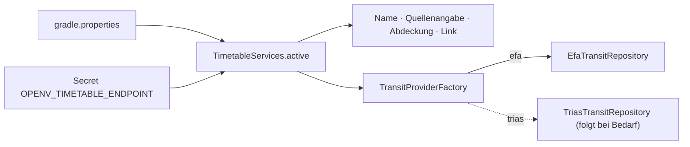

# Fahrplandienste

Öpen-V spricht pro Build genau einen Fahrplandienst an. Name, Quellenangabe, Abdeckung und der Link zu den Nutzungsbedingungen kommen aus einer einzigen Beschreibung: `TimetableService` in [`data/model/TimetableService.kt`](../app/src/main/java/dev/ambivalenton/openv/data/model/TimetableService.kt). Gewählt wird er in [`gradle.properties`](../gradle.properties):

```properties
openv.timetable=vrr            # vrr oder delfi
openv.timetable.protocol=efa   # efa oder trias
```

| Dienst | Abdeckung | Schnittstelle | Stand |
| --- | --- | --- | --- |
| VRR OpenService | Rhein-Ruhr | EFA (JSON) | in Betrieb |
| DELFI-Navi | Deutschland | je nach Zugang EFA oder TRIAS | vorbereitet, nicht aktiv; braucht einen eigenen Zugang |



Alle Builds nutzen heute VRR OpenService.

## Zwei mögliche Wege

Welche Schnittstelle ein weiterer Dienst bereitstellt, legt dessen Zugang fest. Öpen-V ist auf beide üblichen Fälle vorbereitet.

- **EFA:** Öpen-V nutzt den vorhandenen, getesteten EFA-Adapter (StopFinder, Trip, DM, AddInfo). Es ändert sich nur der Endpunkt.
- **TRIAS (VDV 431):** Ein zweiter Adapter `TriasTransitRepository` setzt dieselbe Schnittstelle `TransitRepository` um. Bis er existiert, bricht ein Build mit `openv.timetable.protocol=trias` bewusst mit einem Hinweis ab.

## Checkliste für einen Wechsel

1. **Endpunkt als Secret anlegen** (GitHub → Settings → Secrets and variables → Actions): `OPENV_TIMETABLE_ENDPOINT`, die https-Adresse aus dem Zugang. Zugangsdaten gehören nie ins Repository. Was in die APK kompiliert wird, lässt sich aus ihr auslesen; erlauben die Bedingungen das nicht, braucht es einen eigenen Vermittlungsserver.
2. **Umschalten:** in `gradle.properties` `openv.timetable=delfi` und die Schnittstelle des Zugangs eintragen.
3. **Nur bei TRIAS:** echte Antworten auf LocationInformationRequest, TripRequest, StopEventRequest und, falls angeboten, TripInfoRequest als Test-Fixtures unter `app/src/test/resources/trias/` ablegen; den Adapter gegen diese Antworten schreiben und testen; in `TransitProviderFactory` nach `TimetableServices.active.protocol` wählen; den Abbruch in `app/build.gradle.kts` entfernen. Fehlende Prognosen werden auch hier nie als pünktlich dargestellt.
4. **Texte anpassen:** Datenschutzerklärung (`PRIVACY.md`, `PRIVACY_EN.md`), Abdeckung und Hilfe (`app/src/main/assets/legal/coverage.txt`, `help.txt` samt `en/`), Store-Texte unter `fastlane/` und [data-sources.md](data-sources.md). Danach `python3 tools/sync_publication.py` und `python3 tools/check_release.py`.
5. **Anfrageverhalten abgleichen:** Die Regeln aus [data-sources.md](data-sources.md) gelten unverändert. Vorgaben des Anbieters zu Quoten und Intervallen kommen in `TimetableService.pagingRequests` und `NetworkClient`.
6. **Prüfen:** CI laufen lassen, die Vorschau-App auf dem Gerät mit echten Suchen prüfen und erst dann ein Release taggen.

Gespeicherte Einstellungen bleiben gültig: `AppPublication.settings` setzt beim Laden den Dienst des aktuellen Builds ein.
